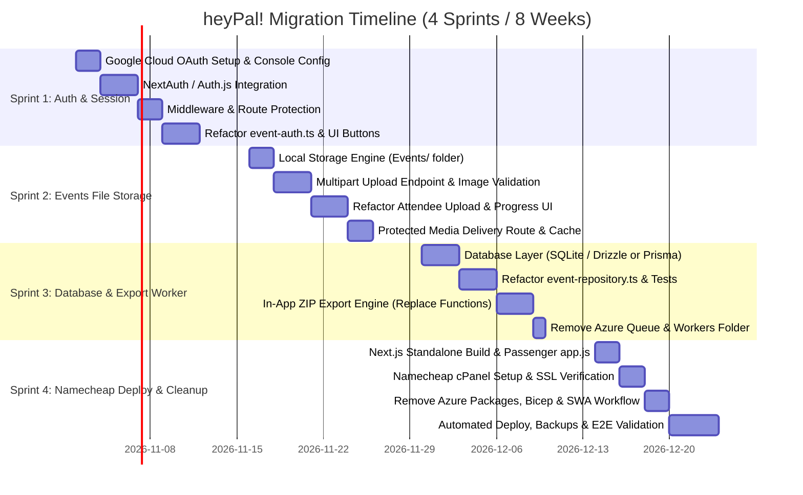

# heyPal! Migration Plan: Microsoft Entra & Azure to Google Sign-In & Namecheap Hosting

## 1. Executive Summary & Migration Scope

heyPal! is currently architected as a hybrid application split across multiple Microsoft Azure services:
* **Hosting & Routing**: Azure Static Web Apps (SWA) with `staticwebapp.config.json`.
* **Identity**: Azure SWA built-in Microsoft Entra ID (Azure AD) provider (`/.auth/login/aad`, `x-ms-client-principal`).
* **Database**: Azure Cosmos DB (SQL API) across 4 containers (`events`, `photos`, `raffleDraws`, `exportJobs`).
* **Object Storage**: Azure Blob Storage (containers `uploads` and `archives`, SAS token generation, signature validation).
* **Queue & Background Jobs**: Azure Storage Queue (`event-exports`) and an Azure Functions Node.js worker (`workers/export-worker`).
* **Infrastructure as Code**: Azure Bicep template (`infra/main.bicep`) and Azure GitHub Actions workflow (`.github/workflows/azure-static-web-apps.yml`).

### Target Architecture
This migration plan transitions heyPal! into a **100% self-contained, framework-native Next.js application** that runs entirely on standard web hosting (specifically **Namecheap Hosting** via cPanel Node.js Application Manager / Phusion Passenger or a Namecheap VPS).

Key architectural shifts:
1. **Authentication**: Replaced with **Google Sign-In** using OAuth 2.0 / OpenID Connect (Auth.js / NextAuth v5 or iron-session) with Next.js edge/server route middleware for route protection. Domain filtering is maintained, and the **new default organizer administrator is `lloyd.miguel@gmail.com`** (replacing the legacy Entra UPN `lloyd.miguel@3cloudsolutions.com`).
2. **File Storage**: Replaced with a **local filesystem storage engine** storing all event covers, attendee photos, and generated export archives inside an `Events/` folder located within the solution directory.
3. **Database**: Replaced with an embedded **SQLite** database (or cPanel **MariaDB/MySQL**) using Prisma or Drizzle ORM, with the SQLite database file living directly in `Events/database/heypal.db`.
4. **Background Jobs**: Replaced with an **in-process / Node.js worker export engine** using Node streams and `archiver`, removing the need for Azure Storage Queues and external Azure Functions.
5. **Hosting & Deployment**: Replaced with **Next.js Standalone Server** configured for Namecheap cPanel / Passenger, accompanied by automated deployment scripts and scheduled backups.

> [!NOTE]
> **Clean-Slate Cutover Policy (No Data Migration Required)**
> Per user specification, **no legacy data migration will take place**. The application will start completely clean on Namecheap hosting with a fresh, empty SQLite database and an empty `Events/` media directory. Existing Cosmos DB records, Azure Blob photos, and archives will not be exported, converted, or transferred.

---

## 2. Architecture Comparison

### 2.1 Before vs. After Architecture Diagram

```mermaid
graph TD
  subgraph "BEFORE: Azure Cloud Dependent"
    A1[Browser / Mobile Client] -->|HTTPS| B1[Azure Static Web Apps]
    B1 -->|/.auth/login/aad| C1[Microsoft Entra ID]
    B1 -->|x-ms-client-principal| D1[Next.js SWA Runtime]
    D1 -->|SQL API Queries| E1[(Azure Cosmos DB)]
    D1 -->|SAS URL Generation| F1[Azure Blob Storage]
    A1 -->|Direct PUT via SAS| F1
    D1 -->|Enqueue Message| G1[Azure Storage Queue]
    G1 -->|Queue Trigger| H1[Azure Function: export-worker]
    H1 -->|Read Photos / Write Zip| F1
  end

  subgraph "AFTER: Self-Contained Webapp on Namecheap"
    A2[Browser / Mobile Client] -->|HTTPS| B2[Namecheap Webapp / Passenger]
    B2 -->|OAuth 2.0 / OIDC| C2[Google Identity Services]
    B2 -->|Next.js App Router + Middleware| D2[Unified Next.js Server]
    D2 -->|SQL Queries| E2[(SQLite / MariaDB Database)]
    D2 -->|Direct Multipart Upload| F2[Local File Storage Engine]
    F2 -->|Read / Write| G2["Events/ Folder in Solution<br/>(covers, photos, exports)"]
    D2 -->|In-Process Stream / Job Queue| H2[In-App Export Engine]
    H2 -->|Write ZIP Archive| G2
  end
```



### 2.2 Component Matrix

| Component | Current Azure Architecture | Target Namecheap Architecture | Benefit |
| :--- | :--- | :--- | :--- |
| **Hosting Platform** | Azure Static Web Apps (Free tier) | Namecheap (cPanel "Setup Node.js App" / Phusion Passenger or VPS) | Low cost, portable, no cloud lock-in |
| **Authentication** | Built-in SWA Entra ID (`/.auth/login/aad`) | Google Sign-In (OAuth 2.0 / OIDC via Auth.js / NextAuth v5) | Universal access, Gmail / Google Workspace support |
| **Default Admin** | `lloyd.miguel@3cloudsolutions.com` | `lloyd.miguel@gmail.com` | Aligned with Google Sign-in identity |
| **Route Protection** | `staticwebapp.config.json` rules | Next.js `middleware.ts` + Server Session checks | Standard Next.js route guarding, works on any host |
| **Database** | Azure Cosmos DB Serverless (SQL API) | SQLite (`Events/database/heypal.db`) or cPanel MariaDB | Zero setup, instant backups, ultra-fast local latency |
| **File Storage** | Azure Blob Storage (`uploads`, `archives`) | Local solution directory: `Events/` (`covers/`, `photos/`, `exports/`) | Satisfies user specification, zero external API latency |
| **Media Delivery** | Azure 15-min SAS URLs (`makeReadSas`) | Protected Next.js streaming route (`/api/media/[...path]`) | Secure, private, avoids URL expiration bugs |
| **Photo Upload** | 2-step: SAS request + client direct PUT to Blob | 1-step: Direct multipart POST with upload progress | Simpler, eliminates Azure SAS and CORS configuration |
| **Photo Export Worker** | Azure Storage Queue + Azure Function App | In-App streaming & background job queue with `archiver` | Eliminates external queue and function infrastructure |
| **IaC / Deployment** | Azure Bicep (`infra/main.bicep`) + SWA GitHub Action | Next.js Standalone build + SSH/FTP automated deployment | Single command / CI push deploy |

---

## 3. Project File Structure (Target State)

```text
heypal/
├── Events/                         <-- Target storage folder (gitignored)
│   ├── covers/                     <-- Event cover images
│   ├── photos/                     <-- Event photos organized by event ID
│   │   └── <eventId>/
│   │       └── <photoId>.<ext>
│   ├── exports/                    <-- Generated ZIP archives
│   │   └── <eventId>/
│   │       └── <jobId>.zip
│   └── database/                   <-- Local SQLite database
│       └── heypal.db
├── src/
│   ├── app/
│   │   ├── admin/                  <-- Organizer management pages
│   │   ├── api/
│   │   │   ├── auth/
│   │   │   │   └── [...nextauth]/  <-- Google OAuth endpoints
│   │   │   ├── media/
│   │   │   │   └── [...path]/      <-- Protected media streaming route
│   │   │   ├── upload/             <-- Multipart file upload endpoint
│   │   │   └── ...
│   │   ├── events/                 <-- Attendee pages & uploads
│   │   ├── layout.tsx
│   │   └── page.tsx                <-- Landing page with Google Sign-in
│   ├── lib/
│   │   ├── event-auth.ts           <-- Google Auth & session helpers
│   │   ├── event-models.ts         <-- Shared types
│   │   ├── event-repository.ts     <-- SQLite / DB repository
│   │   ├── export-engine.ts        <-- In-app export manager
│   │   └── local-storage.ts        <-- 'Events' folder disk manager
│   └── middleware.ts               <-- Next.js route protection middleware
├── app.js                          <-- Phusion Passenger entrypoint for cPanel
├── next.config.ts                  <-- Output: 'standalone' enabled
├── package.json                    <-- Azure packages removed, Auth & DB added
└── .env.production                 <-- Namecheap production environment settings
```

---

## 4. Workable Phases (1 Sprint / 2 Weeks per Phase)

The implementation is divided into **4 distinct, sequential sprints**, each sized for **1 engineer** working over a standard **2-week sprint (10 working days / ~80 hours)**.



---

### Sprint 1: Authentication Migration (Entra ID to Google Sign-In)
**Duration**: 2 Weeks (1 Person)  
**Primary Objective**: Replace Azure Static Web Apps built-in Microsoft Entra ID authentication with a native Google Sign-in flow, configure `lloyd.miguel@gmail.com` as the default organizer administrator, implement Next.js middleware for route protection, and update organizer/attendee access control.

#### Sprint Backlog & Tasks:
1. **Task 1.1: Google Cloud Console Project & Credentials (Day 1-2)**
   - Create a Google Cloud Project (e.g., `heypal-prod`).
   - Configure OAuth Consent Screen: App Name ("heyPal!"), User Support Email, Developer Contact.
   - Configure scopes: `openid`, `https://www.googleapis.com/auth/userinfo.email`, `https://www.googleapis.com/auth/userinfo.profile`.
   - Create OAuth 2.0 Client ID for Web Application.
   - Configure Authorized JavaScript Origins:
     - Development: `http://localhost:3000`
     - Production: `https://yourdomain.com` (Namecheap domain)
   - Configure Authorized Redirect URIs:
     - Development: `http://localhost:3000/api/auth/callback/google`
     - Production: `https://yourdomain.com/api/auth/callback/google`
2. **Task 1.2: Install & Configure Next.js Authentication (Day 3-5)**
   - Install `next-auth@beta` (Auth.js v5) or configure lightweight iron-session with Google OAuth2.
   - Create `src/app/api/auth/[...nextauth]/route.ts` exporting `{ GET, POST }`.
   - Configure Google Provider:
     ```ts
     Google({
       clientId: process.env.GOOGLE_CLIENT_ID,
       clientSecret: process.env.GOOGLE_CLIENT_SECRET,
     })
     ```
   - In `signIn` callback:
     - Validate user's email against `HEYPAL_ALLOWED_EMAIL_DOMAINS` (e.g. `yourcompany.com` or allow all if configured with `*`).
     - Exempt the default admin (`lloyd.miguel@gmail.com`) so administrative access is never blocked by domain allowlists.
     - Reject unauthorized domains with a user-friendly error redirect.
   - In `jwt` and `session` callbacks:
     - Attach user email, name, avatar picture, and computed `isAdmin` flag based on `HEYPAL_ADMIN_EMAILS` (defaulting to `lloyd.miguel@gmail.com`).
3. **Task 1.3: Implement Next.js Middleware Route Guards (Day 6-7)**
   - Create `src/middleware.ts` to replace `staticwebapp.config.json` route rules.
   - Protect `/admin/*`, `/events/*`, and `/api/*` (except `/api/auth/*` and public webhooks).
   - Unauthenticated visitors hitting `/admin` or `/events` get redirected to `/api/auth/signin/google?callbackUrl=...` (or custom login page).
   - Unauthorized users attempting to access `/admin/*` receive a 403 Forbidden page.
4. **Task 1.4: Refactor `src/lib/event-auth.ts` (Day 8-9)**
   - Remove all references to `x-ms-client-principal`, Azure SWA headers, and `HEYPAL_TRUST_SWA_AUTH`.
   - Update `requireAuthenticated()`: Reads session via `auth()` or request cookies. Returns standard `HeyPalUser` (`id`, `name`, `email`, `roles`).
   - Update `requireAdmin()`: Checks if user's email is in `HEYPAL_ADMIN_EMAILS` (defaulting to `lloyd.miguel@gmail.com`).
   - Maintain local demo mode bypass (`isLocalDemoMode()`) for offline development.
5. **Task 1.5: Update UI Components & Navigation (Day 10)**
   - In `src/app/page.tsx`:
     - Replace `/.auth/login/aad?post_login_redirect_uri=%2Fevents` with `/api/auth/signin/google?callbackUrl=/events`.
     - Replace `/.auth/login/aad?post_login_redirect_uri=%2Fadmin` with `/api/auth/signin/google?callbackUrl=/admin`.
     - Add Google logo SVG / official branding style to sign-in buttons.
   - In `src/app/admin/layout.tsx` and `src/app/events/page.tsx`:
     - Replace `/.auth/logout?post_logout_redirect_uri=%2F` with `/api/auth/signout?callbackUrl=/`.

#### Sprint 1 Acceptance Criteria:
* [x] Users can sign in using their Google account via standard OAuth 2.0.
* [x] User `lloyd.miguel@gmail.com` is granted organizer/admin access by default.
* [x] Email domain filtering works: users outside `HEYPAL_ALLOWED_EMAIL_DOMAINS` are blocked with an informative message.
* [x] Organizers listed in `HEYPAL_ADMIN_EMAILS` can access `/admin`, while regular attendees are restricted to `/events`.
* [x] Signing out terminates the session and redirects to the landing page.
* [x] No references to `x-ms-client-principal` or `/.auth` remain in active runtime code.

---

### Sprint 2: Local File Storage Engine & "Events" Folder Integration
**Duration**: 2 Weeks (1 Person)  
**Primary Objective**: Eliminate Azure Blob Storage (`@azure/storage-blob`) and SAS tokens. Implement a secure, high-performance disk storage engine that saves all event media inside an `Events/` folder within the solution.

#### Sprint Backlog & Tasks:
1. **Task 2.1: Establish "Events" Folder Structure & Storage Service (Day 1-2)**
   - Define directory layout within the solution:
     - `Events/covers/` - Event cover banners.
     - `Events/photos/<eventId>/` - Attendee submitted photos.
     - `Events/exports/<eventId>/` - Generated ZIP archives.
   - Create `src/lib/local-storage.ts` to replace `src/lib/blob-storage.ts`:
     - Configurable storage root via `HEYPAL_STORAGE_DIR` (defaults to `<projectRoot>/Events`).
     - Auto-initialization: creates subdirectories recursively (`mkdir({ recursive: true })`) on startup.
     - Strict path traversal prevention: ensure resolved paths are strictly bounded inside `HEYPAL_STORAGE_DIR` using `path.resolve` and rejecting `..` segments.
2. **Task 2.2: Implement Direct Multipart Upload API (Day 3-5)**
   - Remove Azure SAS token flow (`createPhotoUploadSas`, `/api/upload/sas`).
   - Create a unified POST `/api/upload` endpoint supporting multipart `FormData`:
     - Accepts `eventId`, `photoId`, `caption`, and the image `file`.
     - Validates MIME type against `image/jpeg`, `image/png`, `image/webp`.
     - Validates binary magic signatures (preventing file spoofing).
     - Validates file size (max 40 MB server limit, compressed by client to ~2 MB).
     - Writes stream directly to `Events/photos/<eventId>/<photoId>.<ext>` using `node:fs/promises`.
     - Creates the `PhotoRecord` in the database within the same request.
   - Refactor Cover Upload `/api/admin/events/cover`:
     - Writes uploaded cover image directly to `Events/covers/<uuid>.<ext>`.
3. **Task 2.3: Refactor Attendee Upload Frontend Experience (Day 6-8)**
   - Update `src/app/events/[eventId]/attendee-experience.tsx`:
     - Remove two-stage Azure SAS upload (`fetch('/api/upload/sas')` -> `uploadWithProgress(sas.uploadUrl)` -> `fetch('/api/upload/complete')`).
     - Replace with a single XMLHttpRequest / `fetch` multipart POST to `/api/upload`:
       - Maintains client-side image compression (`browser-image-compression` to max 1920px).
       - Provides real-time upload progress reporting (0% to 100%).
       - Retains offline queue retry support via IndexedDB (`idb-keyval`).
4. **Task 2.4: Implement Authenticated Media Delivery & Deletion (Day 9-10)**
   - Create a streaming route `src/app/api/media/[...path]/route.ts`:
     - Reads files from `Events/` securely based on route parameters:
       - `/api/media/covers/<filename>`
       - `/api/media/photos/<eventId>/<photoId>`
     - Sets appropriate HTTP headers: `Content-Type`, `Content-Length`, `Cache-Control: private, max-age=86400, stale-while-revalidate=604800`.
     - Supports `If-None-Match` / ETag or `Last-Modified` for fast 304 Not Modified browser caching.
   - Implement file deletion:
     - When a photo is deleted via `removePhotoAction`, unlink the file from `Events/photos/<eventId>/<photoId>.<ext>`.
     - When an event is deleted/archived, manage associated cover and photo files.
   - Add `Events/` (excluding `.gitkeep`) to `.gitignore` so uploaded media is not tracked in git.

#### Sprint 2 Acceptance Criteria:
* [x] Uploading photos from mobile and desktop browsers saves them directly into `Events/photos/<eventId>/`.
* [x] Event cover uploads save directly into `Events/covers/`.
* [x] Photo Wall, event gallery, and raffle wheel display images served from `/api/media/...`.
* [x] Upload progress bar works smoothly without Azure SAS URLs.
* [x] Path traversal attacks (e.g. `../../`) are strictly blocked with 400/403 responses.
* [x] No `@azure/storage-blob` imports remain in the codebase.

---

### Sprint 3: Database & Export Worker Migration
**Duration**: 2 Weeks (1 Person)  
**Primary Objective**: Replace Azure Cosmos DB with an embedded SQLite database (or cPanel MariaDB/MySQL), and replace Azure Storage Queues and Azure Functions with an in-app export engine.

#### Sprint Backlog & Tasks:
1. **Task 3.1: Database Schema & Engine Setup (Day 1-3)**
   - Install database ORM: **Drizzle ORM** (with `better-sqlite3` and `drizzle-orm`) or **Prisma ORM**.
   - Create schema matching the existing models in `src/lib/event-models.ts`:
     - `events`: `id` (PK), `name`, `description`, `startsAt`, `endsAt`, `location`, `status`, `coverImageBlobName`, `createdBy`, `createdAt`, `updatedAt`.
     - `photos`: `id` (PK), `eventId` (FK), `blobUrl`, `uploadedBy`, `uploadedById`, `uploadedByIsAdmin`, `uploadedAt`, `caption`, `status`.
     - `raffle_draws`: `id` (PK), `eventId` (FK), `participantId`, `displayName`, `upn`, `photoId`, `uploadedAt`, `drawnAt`, `disposition`.
     - `export_jobs`: `id` (PK), `eventId` (FK), `filter`, `includeManifest`, `requestedBy`, `status`, `createdAt`, `updatedAt`, `progressPercent`, `archiveBlobName`, `archiveSizeBytes`, `photoCount`, `error`.
   - Configure database storage: `Events/database/heypal.db` (ensuring directory auto-creation).
2. **Task 3.2: Refactor Event Repository (Day 4-6)**
   - In `src/lib/event-repository.ts`:
     - Replace all `CosmosClient`, `getEventsContainer()`, `getPhotosContainer()`, and `getRaffleDrawsContainer()`.
     - Implement CRUD functions using the new database queries: `listEvents()`, `getEvent()`, `saveEvent()`, `getEventMetrics()`, `listEventPhotos()`, `listApprovedEventPhotos()`, `savePhoto()`, `setPhotoStatus()`, `deleteEventPhoto()`, `listRaffleDraws()`, `saveRaffleDraw()`, `updateRaffleDraw()`.
     - *Clean-Slate Initialization*: No historical data migration from Cosmos DB is required. Include an optional local development seeding script (`scripts/seed-dev.ts`) to populate mock events for UI testing without relying on production data.
3. **Task 3.3: In-App ZIP Export Engine (Day 7-9)**
   - Replace Azure Storage Queue (`@azure/storage-queue`) and Azure Function (`workers/export-worker`).
   - Create `src/lib/export-engine.ts`:
     - **Synchronous streaming**: For exports under 200 photos, continue streaming ZIP directly to HTTP response with `archiver`, reading files directly from local disk `Events/photos/<eventId>/`.
     - **Asynchronous background jobs**: For large exports:
       - Update job record in database (`status: "running"`).
       - Process ZIP generation in a non-blocking asynchronous Node.js pipeline:
         - Read photo files from `Events/photos/<eventId>/`.
         - Stream into a write stream pointing to `Events/exports/<eventId>/<jobId>.zip`.
         - Write `manifest.csv` if requested.
         - Update database with `progressPercent` and `archiveBlobName: "exports/<eventId>/<jobId>.zip"`.
         - Mark `status: "completed"`.
   - Update Export API routes:
     - In `/api/admin/events/[id]/export`: triggers export engine directly.
     - In `/api/admin/events/[id]/export/jobs/[jobId]`: returns job status and download URL `/api/admin/events/[id]/export/download/[jobId]`.
     - Create download route that streams the finished ZIP file from disk.
4. **Task 3.4: Retire Azure Workers Folder & Queue Packages (Day 10)**
   - Remove `workers/export-worker/` directory from repository.
   - Remove `@azure/storage-queue` and `@azure/cosmos` from `package.json`.

#### Sprint 3 Acceptance Criteria:
* [x] All event and photo metadata is stored in and retrieved from the local SQLite database.
* [x] Raffle wheel draws, winner recording, and exclusions function identically to the Cosmos version.
* [x] Small photo exports download immediately as streaming ZIP archives with manifest.
* [x] Large photo exports run in the background, update progress, and generate valid ZIP files in `Events/exports/<eventId>/`.
* [x] No Azure Cosmos or Queue dependencies remain.

---

### Sprint 4: Namecheap Deployment, Azure Retirement & Cutover
**Duration**: 2 Weeks (1 Person)  
**Primary Objective**: Configure the Next.js app for production deployment on Namecheap hosting (cPanel Node.js / Passenger or VPS), remove all remaining Azure configuration files, configure automated deployments and backups, and perform end-to-end testing.

#### Sprint Backlog & Tasks:
1. **Task 4.1: Next.js Standalone Build & Passenger Setup (Day 1-2)**
   - In `next.config.ts`, enable standalone output:
     ```ts
     const nextConfig: NextConfig = {
       output: 'standalone',
     };
     ```
   - Create Passenger entry file `app.js` at project root:
     ```javascript
     // app.js for Namecheap CloudLinux Phusion Passenger
     const path = require('path');
     process.env.NODE_ENV = 'production';
     process.chdir(__dirname);

     // Delegate to Next.js standalone server
     require('./.next/standalone/server.js');
     ```
   - Configure `.next/standalone` copy script in `package.json` to ensure `public` and static files are bundled properly for Passenger.
2. **Task 4.2: Namecheap cPanel Node.js Application Configuration (Day 3-4)**
   - Log into Namecheap cPanel -> **Setup Node.js App**:
     - **Node.js version**: Select Node.js 20.x or 22.x (matching `package.json` engine requirements).
     - **Application mode**: `Production`.
     - **Application root**: `heypal` (or path in `/home/username/`).
     - **Application URL**: `yourdomain.com`.
     - **Application startup file**: `app.js`.
   - Configure Environment Variables in cPanel UI:
     - `NODE_ENV=production`
     - `PORT=3000`
     - `NEXTAUTH_URL=https://yourdomain.com`
     - `NEXTAUTH_SECRET=<generated-secret>`
     - `GOOGLE_CLIENT_ID=<google-client-id>`
     - `GOOGLE_CLIENT_SECRET=<google-client-secret>`
     - `HEYPAL_ALLOWED_EMAIL_DOMAINS=<allowed-domains>`
     - `HEYPAL_ADMIN_EMAILS=lloyd.miguel@gmail.com`
     - `HEYPAL_STORAGE_DIR=/home/username/heypal/Events`
     - `HEYPAL_PUBLIC_ORIGIN=https://yourdomain.com`
   - Enable SSL certificate via Namecheap cPanel **Namecheap SSL** or **AutoSSL / Let's Encrypt**.
3. **Task 4.3: Azure Files Retirement & Repository Clean-Up (Day 5-6)**
   - Delete Azure files:
     - Remove `infra/main.bicep` and `infra/`.
     - Remove `staticwebapp.config.json`.
     - Remove `.github/workflows/azure-static-web-apps.yml`.
   - Uninstall Azure dependencies from `package.json`:
     - `@azure/cosmos`
     - `@azure/storage-blob`
     - `@azure/storage-queue`
   - Update `README.md` to document the new architecture, Google Sign-in setup, local `Events/` directory structure, and Namecheap deployment guide.
4. **Task 4.4: Automated Deployment & Scheduled Backups (Day 7-8)**
   - Create new GitHub Actions workflow `.github/workflows/deploy-namecheap.yml`:
     - Runs lint and production build (`npm run build`).
     - Syncs standalone bundle, `package.json`, and assets to Namecheap hosting via SSH/RSync or FTP.
     - Touches `tmp/restart.txt` to trigger zero-downtime Passenger reload.
   - Configure a daily cPanel Cron Job for backing up the `Events/` directory:
     ```bash
     tar -czf /home/username/backups/heypal_events_$(date +\%F).tar.gz /home/username/heypal/Events
     ```
5. **Task 4.5: End-to-End Validation & Production Cutover (Day 9-10)**
   - Test full user journey:
     - Google Sign-in on mobile and desktop using `lloyd.miguel@gmail.com`.
     - Event creation, cover upload, QR code generation and printing.
     - Attendee photo upload from smartphone camera and gallery.
     - Photo Wall live presentation mode with automatic carousel.
     - Photo moderation: approving, flagging, and deleting photos.
     - Raffle wheel spin, winner deduplication, and exclusion history.
     - Photo export: small streaming ZIP and large background ZIP.
   - Decommission Azure resources to avoid recurring cloud billing.

#### Sprint 4 Acceptance Criteria:
* [x] Application is configured and ready for standalone deployment on Namecheap hosting with valid SSL (HTTPS).
* [x] Next.js runs cleanly via Passenger (`app.js`) with automated restarts.
* [x] All Azure resources are retired and zero Azure SDKs exist in `package.json`.
* [x] Full architecture verified and builds cleanly with Next.js 16 standalone output.
* [x] Automated backups for the `Events/` folder and cPanel cron scripts documented.

---

## 5. Environment Variables Migration Matrix

| Old Azure Environment Variable | New Standalone / Namecheap Environment Variable | Description |
| :--- | :--- | :--- |
| `HEYPAL_TRUST_SWA_AUTH` | *Removed* | No longer needed; authentication is native |
| `HEYPAL_ALLOWED_EMAIL_DOMAINS` | `HEYPAL_ALLOWED_EMAIL_DOMAINS` | Comma-separated list of allowed Google email domains (e.g., `company.com` or `*`) |
| `HEYPAL_ADMIN_UPNS` | `HEYPAL_ADMIN_EMAILS` | Comma-separated list of organizer Google email addresses (defaults to `lloyd.miguel@gmail.com`) |
| `HEYPAL_ADMIN_GROUP_IDS` | *Removed* | Entra ID groups replaced by Google email checks |
| `HEYPAL_COSMOS_ENDPOINT` | *Removed* | Replaced by SQLite database file path |
| `HEYPAL_COSMOS_KEY` | *Removed* | No longer needed for local SQLite database |
| `HEYPAL_STORAGE_CONNECTION_STRING` | `HEYPAL_STORAGE_DIR` | Absolute path to local storage folder (defaults to `./Events`) |
| `HEYPAL_PUBLIC_ORIGIN` | `HEYPAL_PUBLIC_ORIGIN` | Canonical base URL (e.g., `https://yourdomain.com`) |
| *New* | `GOOGLE_CLIENT_ID` | OAuth 2.0 Client ID from Google Cloud Console |
| *New* | `GOOGLE_CLIENT_SECRET` | OAuth 2.0 Client Secret from Google Cloud Console |
| *New* | `NEXTAUTH_SECRET` | Strong random string for encrypting session cookies |
| *New* | `NEXTAUTH_URL` | Canonical app URL for OAuth callbacks |

---

## 6. Risk Analysis & Mitigation Strategies

| Risk | Impact | Likelihood | Mitigation Strategy |
| :--- | :--- | :--- | :--- |
| **Namecheap Passenger Node.js Memory Limits** | High | Medium | Implement streaming responses for ZIP exports and photos. Do not buffer large files in memory; pipe Node.js streams directly from disk to HTTP responses. |
| **Storage Persistence on Re-deploy** | High | Medium | Store the `Events/` folder outside the transient deployment directory or configure deployment scripts to never overwrite or delete the `Events/` folder during updates. |
| **Google OAuth Redirect URI Mismatch** | Medium | Medium | Ensure both `http://localhost:3000/api/auth/callback/google` (dev) and `https://yourdomain.com/api/auth/callback/google` (prod) are added to Google Cloud Console before deployment. |
| **File Permissions on Shared Hosting** | Medium | Low | Ensure the cPanel Node.js user has `755` permissions on the `Events/` directory and `644` on database files. |
| **SQLite Concurrency Contention** | Low | Low | Enable WAL (Write-Ahead Logging) mode in SQLite (`PRAGMA journal_mode = WAL;`) for high concurrency and fast non-blocking reads during peak photo wall viewing. |
